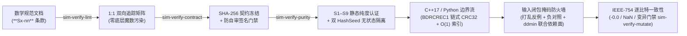

<div align="center">

# S I M - V E R I F Y

**IEEE-754 逐比特确定性仿真验证、输入闭包与 S1–S9 静态纯度认证、并行 `ddmin` 依赖面定位及边界流完整性框架**  
*Bit-Exact Deterministic Simulation Verification, Input-Closure & S1–S9 Purity Certification, Delta-Debugging & Boundary Stream Integrity Toolkit*

[](https://www.python.org/)
[](#)
[-success?style=flat-square)](#)
[](#)
[-6e7681?style=flat-square)](#maintenance)
[](LICENSE)

[**简体中文**](#zh) · [**English**](#en) · [**Русский**](#ru) · [**日本語**](#ja)

</div>

---

<a id="zh"></a>

## 项目概览

**sim-verify** 是一套**零外部依赖**（纯 Python 3.11+ 标准库实现，并附带独立 C++17 高速进程内原生录制端 `sim-verify/native/`）的**确定性物理仿真与数值计算验证工具集**，专为二级动态物理求解器（弹簧骨骼/布料/刚体碰撞）、帧同步（Lockstep）游戏引擎及高精度数值动力系统设计。

在跨平台、多线程或跨语言重构的物理仿真中，传统的浮点近似断言（`assertAlmostEqual`）无法捕捉 `+0.0` 与 `-0.0` 符号翻转、NaN 负载位差异、字典哈希种子依赖、跨帧隐式静态状态泄漏或未登记的越界输入读取。**sim-verify** 提供从数学规范追踪到二进制指针图边界流的全链路形式化与实证门禁。

<a id="maintenance"></a>

> [!NOTE]
> **维护状态声明（As-Is Archival Code Drop）**  
> 本仓库是从已完结研发工程中通用化拆出的**独立技术开源快照**。所有 Python 零依赖模块、C++17 原生录制器与单测套件（缺省未安装可选 `lz4` 时自动跳过 1 项 LZ4 实压用例）均已闭环验证通过。**作者不计划提供后续更新维护、功能开发、Issue 答疑或 PR 审查**。代码基于 [MIT License](LICENSE) 按“原样（As-Is）”开放，欢迎自由 Fork、裁剪或直接内嵌到你的项目中。



---

## 核心架构与模块矩阵

### 1. Python 3.11+ 零依赖验证套件 (`src/sim_verify/`)

| 模块 / CLI | 工程验证能力 | 核心原语 |
| :--- | :--- | :--- |
| **`sim_verify.bitdiff`** | **IEEE-754 逐比特对比与已知缺陷隔离差分 Fuzz**<br/>在 `uint32` 原始比特层面对比 `float32` 序列（严格区分 `-0.0` 与 `+0.0` 及不同 NaN 负载位），并在种子差分 Fuzz 中将已知参考缺陷隔离到精确字节区间。 | `compare_f32_arrays()`<br/>`run_differential_fuzz()` |
| **`sim_verify.stateless_check`** | **沙盒化无状态步进运行时隔离**<br/>结合 AST 静态检查、`sys.addaudithook` 内核审计钩子（拦截一切文件/网络/子进程副作用）以及双 `PYTHONHASHSEED` (`1` vs `2`) 独立子进程冷启动执行，证明单步函数零跨帧隐式状态。 | `guarded_call()`<br/>`check_ast_stateless()`<br/>`run_isolated_steps()` |
| **`sim_verify.purity_verifier`**<br/>`sim-verify-purity` | **形式化受限子集 Python 纯函数静态认证器（规则 S1–S9）**<br/>结合跨过程持久度数据流分析、独立子进程导入期值分类（`frozen` 深度不可变 / `data` 只读查表 / `opaque` 不透明对象）与提及闭包（Mention-Closed）上的 S3–S9 语法限制，彻底封死模块可变对象、类属性、闭包、栈帧、`__wrapped__` 与 `setattr` 等全部跨调用状态通道。 | `verify_package_purity()`<br/>`sim-verify-purity` |
| **`sim_verify.input_closure`** | **输入闭包字节掩码防火墙、打乱反例与负对照消融**<br/>支持整块、显式区间、定步长数组元素切片（`stride` + `start_index`）、分层掩码与机械禁读防火墙（`FirewallViolation`）；提供将白名单外全部字节随机打乱的自由运行不变性证明（Scramble Counterexample）及逐项扣减白名单的负对照消融证明（Negative-Control Ablation）。 | `ByteMask`, `MaskedView`<br/>`verify_scramble_invariance()`<br/>`verify_negative_control_ablation()` |
| **`sim_verify.dep_surface`** | **多掩码比特翻转与并行 `ddmin` 联合输入依赖面认证器**<br/>使用多组 XOR 掩码扰动状态模板并自动分类为 `unread` / `overwritten` / `mixed` / `dependency` / `rejected`；通过二分集体翻转与补集 **Delta-Debugging (`ddmin_shrink`)** 隔离“单改不触发、组合改才触发”的最小联合依赖集（Joint Dependencies），迭代至全掩码不动点。 | `ddmin_shrink()`<br/>`settle_dependency_surface()`<br/>`certify_dependency_surface()` |
| **`sim_verify.boundary_recorder`** | **CRC32 链式指针图边界流录制与自检 (`BDRCREC1`)**<br/>基于声明式 JSON 规则遍历内存指针图，生成每条记录带 CRC32 且尾部链式串联的 `BDRCREC1` 二进制流，自动检测调用期内只读违例（`ST_READONLY`）与跨帧未知写入者（Unknown Writers）。 | `Rules`, `Walker`<br/>`Writer`, `read_stream()`<br/>`check_stream()` |
| **`sim_verify.boundary_index`** | **多 GB 边界流 $O(1)$ 偏移索引、帧间隔画像与并发不变配对**<br/>单遍校验全部记录 CRC 构建轻量偏移索引，支持 $O(1)$ 随机 seek 读取任意单帧而不将数 GB 流读入内存；提供 `mmap` 帧间隔分位数与写盘阻塞相关性分析、多线程调度顺序不变的跨帧 `(unit_id, occurrence)` 配对，以及单调两连增起点门状态机 `MonotonicStartGate`。 | `build_stream_index()`<br/>`IndexedBoundaryReader`<br/>`profile_stream_intervals()`<br/>`pair_cross_frame_invariant()`<br/>`MonotonicStartGate` |
| **`sim_verify.stream_store`** | **双 SHA-256 有界 LZ4 流存储与命名管道零落盘重打包**<br/>强制要求 LZ4 帧启用 `block_checksum` + `content_checksum` 且块上限 `4 MiB`、逻辑流上限 `128 GiB`，同步计算物理压缩流与逻辑解压流双 SHA-256；提供基于 Windows `CreateNamedPipeW` 4 MiB 命名管道的零落盘流式重打包器。 | `open_bounded_stream()`<br/>`compute_dual_sha256()`<br/>`NamedPipeRepacker` |
| **`sim_verify.disk_index`** | **SQLite 磁盘硬限额前缀无损编码去重索引**<br/>基于 `WITHOUT ROWID` SQLite 表与 `PRAGMA max_page_count` 严格限制磁盘字节上限，使用规范前缀无损二进制编码对海量 64 位整数/元组/字节键进行去重。 | `DiskCappedIndex`<br/>`encode_u64_tuple()` |
| **`sim_verify.mutation_gate`**<br/>`sim-verify-mutate` | **跨语言锚点驱动源码变异测试门禁**<br/>支持文本/正则锚点与 LF/CRLF 自动适配，在独立临时目录中逐个注入变异体并运行测试命令，强制要求未变异对照组 `M0` 通过且所有移除安全检查的变异体 `M1..Mn` 被测试集击杀。 | `MutantSpec`, `apply_mutations()`<br/>`run_mutation_gate()`<br/>`sim-verify-mutate` |
| **`sim_verify.spec_lint`**<br/>`sim-verify-lint` | **形式化规范无污染检查与追踪矩阵对齐门禁**<br/>拦截混入数学规范的十六进制地址、寄存器偏移或本地路径，并验证规范中的 `**Sx-nn**` 条款与追踪矩阵表 1:1 双向精确对齐。 | `scan_text()`<br/>`check_spec_pair()`<br/>`sim-verify-lint` |
| **`sim_verify.provenance`**<br/>`sim-verify-contract` | **流式 SHA-256 产物契约冻结与防自审评审门禁**<br/>为基线文件生成流式 SHA-256 清单，并强制执行同行评审门禁（自动拒绝 `author == reviewer` 自审或存在未清零 `must_fix` 的评审记录）。 | `freeze_contract()`<br/>`verify_contract()`<br/>`sim-verify-contract` |
| **`sim_verify.partest`**<br/>`sim-verify-partest` | **进程隔离并行单测运行器（含超时进程树清理）**<br/>在独立子进程池中并行执行 `unittest` 模块，支持严格单模块超时（Windows 下自动 `taskkill /T /F` 清理挂起进程树）与已知失败基线门禁。 | `run_module()`<br/>`sim-verify-partest` |
| **`sim_verify.pcore_run`**<br/>`sim-verify-pcore` | **Windows 混合架构大小核 P-Core 拓扑绑定调度器**<br/>调用 `GetSystemCpuSetInformation` 自动筛选最高 `EfficiencyClass` 的性能核（P-Core），消除 Intel/AMD 大小核架构下的基准测试抖动。 | `select()`<br/>`select_highest_efficiency_cpu_sets()`<br/>`sim-verify-pcore` |
| **`sim_verify.msvc_ninja`** | **可复现 MSVC + Ninja Multi-Config 构建驱动**<br/>通过 `vswhere` 自动定位 Visual Studio `vcvars64.bat` 与内置 `Ninja`，在 Python 中驱动干净的 `Debug` / `Release` C++ 构建。 | `configure()`, `build()`<br/>`env()` |

### 2. C++17 原生高速进程内边界流录制器 (`native/`)

| 组件 (`sim-verify/native/`) | 核心工程特性 |
| :--- | :--- |
| **`include/sim_verify/boundary_walk.h`**<br/>`src/boundary_walk.cpp` | **SEH 野生指针安全遍历器与零堆分配 BSS 哈希表**：使用 Windows SEH (`__try / __except`) 与 `readable_quick()` 快速探针实现零崩溃内存读取（遇到野指针返回 `ST_WALK` 而不崩溃）；将 16,384 槽 `SeenTable` 与 8,192 槽 `TreeSeen` 置于进程级 BSS（以零堆 `SRWLOCK` 保护），避免占用宿主线程栈；支持 `Region`/`Ptr`/`Deref`/`VecPtr`/`Vec`/`VTable`/`Tree` 及有界链表 `List` 遍历。 |
| **`include/sim_verify/boundary_writer.h`**<br/>`src/boundary_writer.cpp` | **编译期 `constexpr` Slicing-by-8 CRC32 与 4 MiB 背压写入器**：产出与 Python 端 `sim_verify.boundary_recorder` 及 `sim_verify.boundary_index` 100% 二进制兼容的 `BDRCREC1` 流；内置 `4 MiB` 阻塞式背压缓冲（永不丢帧）、每帧 `QPC` `write_ticks` 写盘耗时统计与 `check_disk_floor()` 磁盘水位熔断。 |
| **`include/sim_verify/boundary_session.h`**<br/>`src/boundary_session.cpp` | **按对象粒度并发重叠污点追踪与无锁 TLS RLE 采样器**：`OverlapTracker` 精确区分“同对象跨线程并发冲突（双向打污点 `ST_OVERLAP`）”、“不同对象并行无冲突”与“同线程递归重入（`ST_RECURSE`）”；`TlsRleSampler` 以单次 TLS 分支在热路径上对高频标量做无锁游程编码（RLE）。 |
| **`tools/gen_rules_inc.py`**<br/>`tests/test_native_recorder.cpp` | **JSON 规则表 → C++ `.inc` 静态表编译器与原生单测套件**：将 JSON 指针图规则编译为带 SHA-256 绑定的 C++17 `constexpr` 规则表。 |

---

## 快速上手与验证

### 1. 安装与运行 Python 全量测试（29 项单测，含 C++17 原生流跨语言互检，零外部依赖）

```bash
pip install -e .
python -B -m unittest discover -s tests -v
```

### 2. 编译并运行 C++17 原生录制器与跨语言流互检

```bash
cmake -B native/build -S native
cmake --build native/build --config Release
./native/build/Release/sim_verify_recorder_test
```

### 3. 核心 API 示例

```python
import random
from sim_verify.bitdiff import compare_f32_arrays
from sim_verify.input_closure import ByteMask, MaskedView, scramble_outside_mask

# 1. IEEE-754 逐比特对比：严格区分 +0.0 (0x00000000) 与 -0.0 (0x80000000)
diff = compare_f32_arrays([1.0, 0.0], [1.0, -0.0])
assert diff["all_bitwise_equal"] is False

# 2. 输入闭包掩码防火墙 + 白名单外随机打乱反例
mask = ByteMask({
    "categories": ["state"],
    "copy": [{"id": "pos", "source": "entry", "category": "state", "ranges": [["0x0", "0x8"]]}],
    "forbidden": [{"source": "entry", "category": "state", "ranges": [["0x10", "0x20"]]}],
})
regions = [(0x1000, 32, 0)]
allowed = mask.allowed(regions, "entry")
scrambled = scramble_outside_mask([(0x1000, b"\x01" * 32)], allowed, random.Random(42))
view = MaskedView(scrambled, allowed)
assert view.read(0x1000, 8) == b"\x01" * 8  # 白名单内逐字节保留；读 0x1008 将抛出 MaskViolation
```

---

<a id="en"></a>

## English Documentation

**sim-verify** is a zero-dependency verification and quality-assurance framework (pure Python 3.11+ stdlib, bundled with a standalone C++17 in-process high-speed boundary recorder under `native/`) engineered for **deterministic physics solvers, numerical simulations, lockstep game engines, and dynamical systems**.

> [!NOTE]
> **Maintenance Policy (As-Is Archival Release)**  
> This repository is a self-contained technical code drop extracted from a completed R&D project. All 15 Python modules, the C++17 native recorder, and all unit test suites are verified and passing. **The author does not plan to provide ongoing maintenance, issue triage, or PR reviews.** Released "as-is" under the [MIT License](LICENSE)—feel free to fork, vendor, or adapt it.

### Key Highlights
- **IEEE-754 Bitwise Comparison & Stateless Isolation (`bitdiff`, `stateless_check`)**: Compares `float32` buffers at the raw `uint32` bit level (distinguishing `-0.0` from `+0.0` and distinct NaN payloads) and proves zero cross-tick in-process state via `sys.addaudithook` traps and dual-`PYTHONHASHSEED` subprocess execution.
- **Formal S1–S9 Python Purity Certifier (`purity_verifier` / `sim-verify-purity`)**: Combines interprocedural persistence-level dataflow analysis, fresh-subprocess import-time value classification (`frozen` / `data` / `opaque`), and syntactic S3–S9 restrictions over mention-closed call graphs to close every CPython cross-call state channel.
- **Input-Closure Byte-Mask Firewall & Parallel `ddmin` Dependency Surface Certifier (`input_closure`, `dep_surface`)**: Enforces declarative whole/ranged/strided byte whitelists with mechanical forbidden-range firewalls (`MaskedView`), proves zero unwhitelisted reads via seeded random scrambling, proves non-vacuity via negative-control ablation, and isolates minimal **joint dependencies** via multi-mask XOR bit-flipping and complement Delta-Debugging (`ddmin_shrink`).
- **CRC32-Chained Boundary Streams, $O(1)$ Multi-GB Indexer & C++17 Native Recorder (`boundary_recorder`, `boundary_index`, `stream_store`, `disk_index`, `native/`)**: Traverses pointer graphs into tamper-evident `BDRCREC1` streams with $O(1)$ offset-indexed frame seeking, `mmap` frame-interval profiling, thread-schedule-invariant `(unit_id, occ)` cross-frame pairing, dual-SHA256 bounded LZ4 streams, Windows 4 MiB named-pipe zero-disk repacking, disk-capped SQLite deduplication, and an SEH-guarded C++17 native recorder featuring compile-time `constexpr` Slicing-by-8 CRC32 and lock-free TLS RLE sampling.

---

<a id="ru"></a>

## Документация на русском

**sim-verify** — это фреймворк верификации и контроля качества без внешних зависимостей (чистая стандартная библиотека Python 3.11+ в паре с высокоскоростным внутрипроцессным рекордером на C++17 в `native/`), разработанный для **детерминированных физических солверов, численного моделирования, lockstep-движков и динамических систем**.

> [!NOTE]
> **Статус поддержки (As-Is / Архивный релиз)**  
> Данный репозиторий представляет собой завершённый технический релиз (code drop), выделенный из закрытого исследовательского проекта. Все модули Python, нативный рекордер C++17 и тесты полностью работоспособны. **Автор не планирует активно поддерживать репозиторий, отвечать на Issues или принимать PR.** Код предоставляется «как есть» (As-Is) под лицензией [MIT](LICENSE) — вы можете свободно форкать и встраивать его в свои проекты.

### Основные возможности
- **Побайтовая сверка IEEE-754 и изоляция шагов без состояния (`bitdiff`, `stateless_check`)**: Сверка буферов `float32` на уровне сырых битов `uint32` (различая `-0.0` и `+0.0`, а также полезную нагрузку NaN) и доказательство отсутствия скрытого состояния между шагами с помощью ловушек `sys.addaudithook` и запуска в изолированных подпроцессах с разными `PYTHONHASHSEED`.
- **Формальный статический верификатор чистоты Python S1–S9 (`purity_verifier` / `sim-verify-purity`)**: Объединяет межпроцедурный анализ потоков данных, классификацию значений модулей при импорте в отдельном подпроцессе (`frozen` / `data` / `opaque`) и синтаксические правила S3–S9 на замкнутом графе вызовов, блокируя любые каналы сохранения мутабельного состояния в CPython.
- **Брандмауэр входного замыкания и сертификация поверхности зависимостей через `ddmin` (`input_closure`, `dep_surface`)**: Декларативные байтовые маски (включая срезы массивов с шагом `stride` и запрещённые диапазоны `FirewallViolation`), доказательство нечувствительности к шуму вне маски (Scramble Counterexample), негативный абляционный контроль, а также поиск минимальных **совместных зависимостей (Joint Dependencies)** методом многомасочного XOR-флиппинга и Delta-Debugging (`ddmin_shrink`).
- **Потоки границ графов указателей `BDRCREC1`, $O(1)$-индексатор многогигабайтных трасс и нативный C++17 рекордер (`boundary_recorder`, `boundary_index`, `stream_store`, `disk_index`, `native/`)**: Цепочки CRC32 для защиты от усечения и подмены, $O(1)$-доступ к кадрам без загрузки многогигабайтных файлов в ОЗУ, инвариантное к расписанию потоков сопоставление `(unit_id, occ)`, ограниченные потоки LZ4 с двойным SHA-256, перепаковка через именованные каналы Windows (`CreateNamedPipeW`), SQLite-индекс с жёстким лимитом диска и нативный рекордер C++17 с защитой SEH, `constexpr` Slicing-by-8 CRC32 и lock-free TLS RLE-сэмплером.

---

<a id="ja"></a>

## 日本語ドキュメント

**sim-verify** は、**決定論的物理ソルバー（揺れ物・クロスシミュレーション等）、ロックステップ型ゲームエンジン、高精度数値計算基盤**のために設計された、外部依存ゼロ（Python 3.11+ 標準ライブラリのみ、C++17 ネイティブ高速レコーダ `native/` 同梱）の検証・品質保証フレームワークです。

> [!NOTE]
> **メンテナンス方針（現状渡し / アーカイブ公開）**  
> 本リポジトリは完了した研究開発プロジェクトから汎用コンポーネントを抽出・公開したコードドロップです。全 Python モジュール・C++17 ネイティブレコーダおよび単体テストは検証済みですが、**今後の継続的なメンテナンスや Issue / PR 対応は予定していません**。[MIT License](LICENSE) の下で現状渡し（As-Is）として公開されており、自由なフォークや組み込みが可能です。

### 主な機能
- **IEEE-754 ビット完全一致検証＆ステートレス隔離 (`bitdiff` / `stateless_check`)**：`+0.0` と `-0.0` の符号反転や NaN ペイロード差を `uint32` レベルで検出し、`sys.addaudithook` と異なる `PYTHONHASHSEED` サブプロセス実行によりフレーム間の隠れた状態を排除します。
- **S1–S9 制限サブセット Python 静的純粋性認証 (`purity_verifier` / `sim-verify-purity`)**：手続き間永続度データフロー解析、サブプロセスでのインポート時値分類（`frozen` / `data` / `opaque`）、および閉包コールグラフ上の S3–S9 構文制約により、CPython における状態残留チャネルを完全に封鎖します。
- **入力閉包バイトマスク・ファイアウォール＆並列 `ddmin` 依存面認証 (`input_closure` / `dep_surface`)**：ストライド対応マスクと禁止領域ファイアウォール（`MaskedView`）、マスク外ランダム攪乱反例（Scramble Counterexample）、負対照アブレーションに加え、マルチマスク XOR 反転と補集合 Delta-Debugging（`ddmin_shrink`）により最小の**結合依存集合（Joint Dependencies）**を自動特定します。
- **CRC32 チェーン境界ストリーム (`BDRCREC1`)・大容量 $O(1)$ 索引・C++17 ネイティブレコーダ (`boundary_recorder` / `boundary_index` / `stream_store` / `disk_index` / `native/`)**：数 GB の境界ストリームをメモリに保持せず $O(1)$ シークするオフセット索引、スレッドスケジュール不変の `(unit_id, occ)` フレーム間照合、二重 SHA-256 有界 LZ4 ストリームと Windows 名前付きパイプ再パック、ディスク上限付き SQLite 去重索引、および SEH 保護・`constexpr` Slicing-by-8 CRC32・TLS RLE サンプラを備えた C++17 ネイティブ実装を提供します。

---

## License

Released under the [MIT License](LICENSE).
